# Alphabet

## Vowels
| Sound | Character |
| :------: | :---------: |
| A |  |
| E | 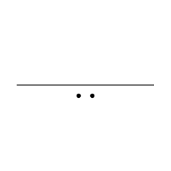 |
| I | 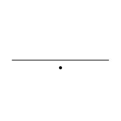 |
| O |  |
| U |  |
| AE |  |
| A_Back | 

## Consonants
| Sound | Character |
| :------: | :---------: |
| P |  |
| B | 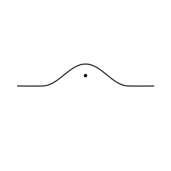 |
| F | 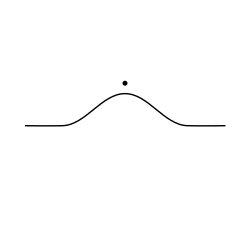 |
| V |  |
| T | 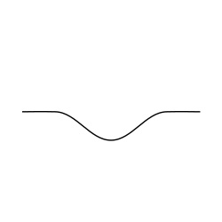 |
| D |  |
| TH |  |
| DH | 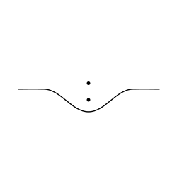 |
| K |  |
| G | 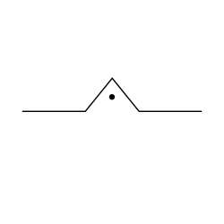 |
| CH |  |
| J |  |
| S |  |
| Z | 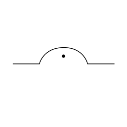 |
| SH | 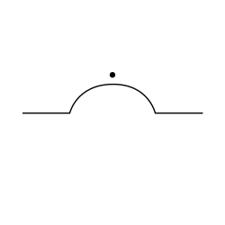 |
| ZH |  |
| M | 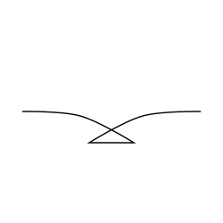 |
| N | 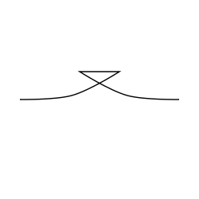 |
| L |  |
| R | 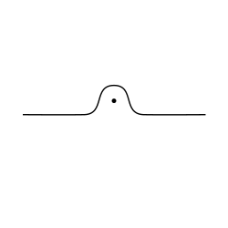 |
| H | 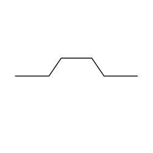 |
| W |  |
| Y |  |